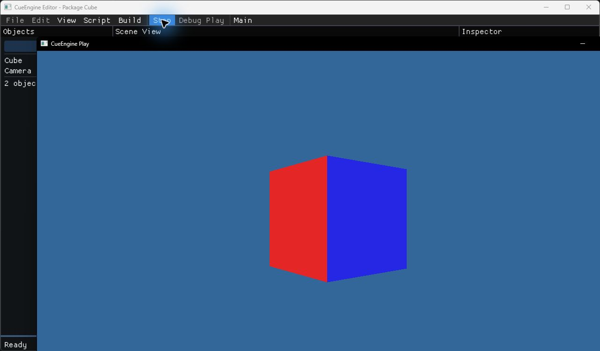

[CueHub と Engine のインストール](./install.md) が済んだら、空の Project に Cube と C++ Script を追加し、Cube が回るアプリを作ります。

## Project を作る

1. Hub の **プロジェクト** 画面で、右上の **新しいプロジェクト** を押します。
2. 作成ページで使用する Engine、表示名、アプリ識別名、保存先を入力し、**作成** を押します。テンプレートの選択はありません。
3. 作成した Project を一覧で選び、**Editor で開く** を押します。

## Editor で Cube を追加する

1. Editor で起動シーン `Main` を開きます。**Objects → Add Cube** で Cube を追加します。
2. Project の `Source/Game.cpp` を Visual Studio などで開き、先頭に `#include <chrono>` と `#include <Math/Quaternion.h>` を追加します。
3. `EmptyBehaviour` の `update()` を下記の実装へ置き換えて保存します。

```cpp
[[nodiscard]] cue::Result<void> update(cue::GameObject &a_object,
                                     const cue::ScriptUpdateContext &a_context) override
{
    auto transform = a_object.transform();
    if (!transform.has_value())
        return cue::Result<void>::failure(*transform.try_error());

    const auto seconds = std::chrono::duration<float>(a_context.deltaTime).count();
    auto delta = cue::math::rotation_axis_angle(cue::math::float3{0, 1, 0},
                                               cue::math::degrees_to_radians(90.0f) * seconds);
    if (!delta.has_value())
        return cue::Result<void>::failure(*delta.try_error());

    auto rotation = cue::math::normalize(*delta.try_value() * transform.try_value()->rotation);
    if (!rotation.has_value())
        return cue::Result<void>::failure(*rotation.try_error());

    transform.try_value()->rotation = *rotation.try_value();
    return a_object.set_transform(*transform.try_value());
}
```

4. **Script → Build Scripts** を実行し、ビルドが終わるまで待ちます。
5. Cube を選び、Inspector の **Add Script** で **Empty Behaviour** を選びます。これは生成時に用意された Script 型の表示名です。
6. **File → Save Scene** で保存します。**Play** を押すと別ウィンドウで回転を確認できます。確認後は **Stop** を押します。



:::note 起動シーン

現在の Preview では、製品ビルドには Project の起動シーンが使われます。この手順では新規 Project の起動シーン `Main` を編集します。

:::

## Windows アプリをビルドする

1. **Build → Build Settings...** を開き、**Windows**、**x64**、**Release** を選びます。
2. **Build** を押し、完了まで待ちます。失敗した場合は **Build Log** で詳細を確認できます。
3. **Run** で生成アプリを開き、追加した Cube が回り続けることを確認します。生成されたアプリは、Project の `Build/Windows/x64/Release/Player` にあります。
4. Editor を閉じた後もアプリが動くことを確認し、最後にアプリのウィンドウを閉じます。
